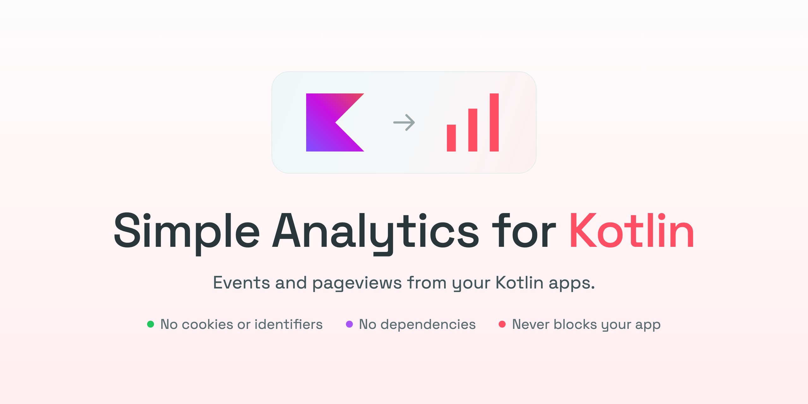

# Simple Analytics for Kotlin

Send events and pageviews from your Kotlin app to [Simple Analytics](https://simpleanalytics.com), with no cookies and no user identifiers.

## Features

- **Events with details:** count what people do, such as `buy_clicked` with `source=toolbar`.
- **Pageviews for app screens:** see your app's screens in the dashboard's pages report, just like a website.
- **Country, language and screen reports out of the box:** the computer's timezone, language and screen size are sent automatically.
- **Accurate visitor counts:** each run of your app counts as one visit, not every screen it shows.
- **Time on page:** see how long people keep each screen on view. Time while the app is minimised doesn't count, with nothing for you to wire up.
- **Works offline:** events recorded without a connection wait and are sent once it's back, landing on the day they happened. They can even survive the app quitting.
- **Never slows down or crashes your app:** events are sent on a background thread. Invalid names, failed requests and network errors are logged and dropped, never thrown.
- **Sends what's left when the app quits:** events recorded right before quitting, and the last screen's time, still arrive.
- **Kotlin Multiplatform:** add it to the common code of projects that target the JVM.

## Installation

Add the dependency to your `build.gradle.kts`:

```kotlin
dependencies {
    implementation("com.alexstyl:simple-analytics-kotlin:0.2.0")
}
```

The library is published on Maven Central, so make sure `mavenCentral()` is in your repositories.

## Quick start

First add your app as a website in the Simple Analytics dashboard, using a hostname such as `app.example.com`. Then send your first event by starting a session with that hostname and your app's name and version, and calling `track()`:

```kotlin
val analytics = SimpleAnalytics(hostname = "app.example.com", appName = "MyApp", appVersion = "1.0.0").start()

analytics.track("app_opened")
```

`SimpleAnalytics()` only holds your settings. Recording and sending begin with `start()`, and end with `stop()` or when your app quits.

`app_opened` shows up in the dashboard's events report for `app.example.com`, along with the visitor's country, language, operating system and screen size.

## Examples

### Track a button click

To tell apart which button people clicked, pass details as metadata to `track()`:

```kotlin
analytics.track("buy_clicked", mapOf("source" to "toolbar"))
```

Event names can only contain lowercase letters, digits and underscores. Other names are logged and not sent.

### Track screen views

To count how often a screen is shown, call `pageview()` with a path for that screen whenever your app navigates to it:

```kotlin
analytics.pageview("/settings")
```

Each screen appears in the dashboard's pages report. Call it from your navigation code rather than from UI code that can run many times for the same screen.

### See how long people spend on each screen

Each screen's time on view is measured from its `pageview()` until the next one, and shows up as time on page in the dashboard's pages report. There's nothing to turn on:

```kotlin
analytics.pageview("/")          // the home screen shows; its clock starts
analytics.pageview("/settings")  // the 42 seconds on / are added to its pageview
```

Only time while your app is on view counts: on desktop the clock pauses by itself while all your app's windows are minimised or closed. The time of the last screen is sent when the app quits.

### Keep time on page when the app is killed

An app that's force-quit or crashes can't report how long its last screen was on view. To keep a lower bound, pass `pings`, and the time on view is also sent as it passes each of them:

```kotlin
val analytics = SimpleAnalytics("app.example.com", "MyApp", "1.0.0", pings = listOf(5.seconds, 60.seconds)).start()
```

### Count visitors

The dashboard counts a visitor for the first pageview of each session, so start one when your app starts and use it for the whole run. Its visitors are then your app's runs:

```kotlin
val analytics = SimpleAnalytics("app.example.com", "MyApp", "1.0.0").start()

analytics.pageview("/")         // a visitor
analytics.pageview("/settings") // not a new visitor
```

### Stop sending

To stop recording before your app quits, such as when someone turns analytics off in your settings, call `stop()`. Events already recorded are still sent, and the current screen's time on view is added:

```kotlin
analytics.stop()
```

To send again, call `start()` on your settings for a new session, which counts as a new visit.

### Keep events recorded offline

When the computer is offline, events wait and are retried with increasing delays, up to every 5 minutes. They keep the time they happened, so they land on the right day in the dashboard. By default they wait in memory and are lost if the app quits first. To keep them until the next run, pass a `queueDirectory`, such as your app's data folder:

```kotlin
val analytics = SimpleAnalytics("app.example.com", "MyApp", "1.0.0", queueDirectory = File(appDataDir, "analytics")).start()
```

To keep them somewhere else, such as your app's database, pass your own `QueueStorage` as `queueStorage` instead.

Up to 1000 events wait at a time, and events older than 72 hours are dropped. Run one session at a time for each hostname and directory.

Pageviews sent more than a minute after they happened, such as after being offline, keep the time they happened but get no time on page.

## Troubleshooting

### Events don't show up in the dashboard

Check that `hostname` exactly matches a website you added in Simple Analytics, such as `app.example.com`. The dashboard only shows data for the websites in your account.

### "Simple Analytics will count … as a robot"

Simple Analytics leaves out traffic from user agents containing `bot`, `spider`, `crawl` or `agent`. Choose an app name without those words, such as `MyApp` instead of `MyApp Agent`.

### "Not sent to Simple Analytics"

An event name or path was invalid. Event names can only contain lowercase letters, digits and underscores, and paths must start with `/`.

### "Simple Analytics refused … with 403"

Simple Analytics doesn't accept data for a hostname that isn't in an account. Check the `hostname` against your dashboard.
